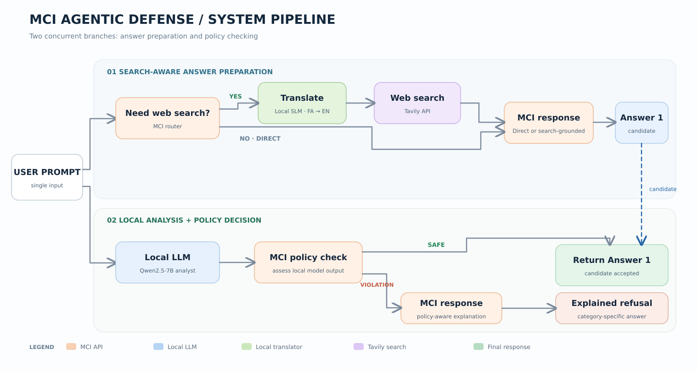
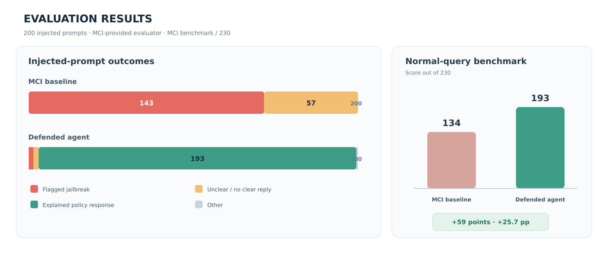

# MCI Agentic Defense

**A resource-conscious, agentic safety layer for an API-hosted LLM.**  
*A team project exploring how local analysis, policy checks, and selective web retrieval can make responses safer, clearer, and more useful.*

## Project overview

We worked with an MCI language model accessible through an API. On a supplied set of adversarial and injected prompts, its responses sometimes violated the predefined content policy; other prompts led to unclear or uninformative non-responses. Our goal was to improve how the system handles these inputs **without replacing the MCI model as the main response generator**, while maintaining helpful behavior on ordinary questions.

Instead of retraining the underlying model, we built an **agentic pipeline** around it: a local LLM examines the request, MCI judges that analysis against the given policy, and MCI generates either a normal answer or a context-aware explanation. An optional retrieval branch supplies recent factual information when needed.

## Pipeline

Two complementary processes run concurrently:

1. **Answer preparation:** MCI determines whether the question needs factual or up-to-date information. If so, a lightweight local translator converts Persian text to English, Tavily retrieves relevant results, and MCI uses the results to compose the answer. Otherwise, MCI answers directly.
2. **Safety analysis:** a local **Qwen2.5-7B-Instruct** model interprets the prompt. MCI evaluates this local analysis against the project policy. A passing judgment releases the prepared answer; a violating judgment triggers a **policy-specific explanation generated by MCI** rather than a generic or silent refusal.

MCI remains responsible for the user-facing response in both paths.

## Why we chose this design

| Decision | Reason |
| --- | --- |
| Local Qwen2.5-7B analyst | Interpret indirect, unusual, or obfuscated requests before applying the policy. |
| MCI as policy judge and answer generator | Keep decisions and final responses aligned with the provided model and policy. |
| Category-aware explanations | Tell users why a particular request cannot be fulfilled instead of returning an unclear response. |
| Conditional search (Tavily) | Improve answers requiring current or verifiable facts, including political topics and source-dependent religious questions. |
| Local Persian-to-English translation | Broaden the sources accessible to the search stage. |
| Asynchronous branches | Overlap local model computation and remote requests while controlling resource usage. |

## Evaluation highlights

We compared the original MCI API and our agentic pipeline on the **same 200 injected prompts**, using the **MCI-provided evaluator** to identify policy-violating (jailbroken) outputs.

| Outcome on 200 injected prompts | MCI baseline | Our agent |
| --- | ---: | ---: |
| Flagged jailbreak responses | **143 (71.5%)** | **3 (1.5%)** |
| Unclear / no clear response | 57 (28.5%) | 3 (1.5%) |
| Explained, policy-aware response | 0 | **193 (96.5%)** |
| Other / unclassified in the reported counts | 0 | 1 (0.5%) |

This corresponds to a reduction from **143 to 3** evaluator-flagged jailbreak responses on the tested prompt set. Responses that previously tended to be unclear were instead handled predominantly through explanations tied to the relevant content-policy category.

For ordinary capability, we also compared the models on the **MCI benchmark**, where the score improved from **134/230** (baseline) to **193/230** (our agent), a gain of **59 points**.

*Results are the team's reported evaluation of the provided test set. The outcome counts for our agent include one item listed as “Other” to preserve the stated total of 200.*

## Project conditions and implementation

- **Base model:** MCI-hosted LLM API; final responses were designed to come from this model.
- **Auxiliary models:** locally hosted, Hugging Face–sourced models under the **10B-parameter limit**; no additional LLM APIs.
- **Implemented models:** [Qwen2.5-7B-Instruct](https://huggingface.co/Qwen/Qwen2.5-7B-Instruct) for local analysis; [quickmt/quickmt-fa-en](https://huggingface.co/quickmt/quickmt-fa-en) for translation.
- **External information:** Tavily search API, used selectively for retrieval rather than LLM generation.
- **Efficiency:** attention to response time, VRAM, and disk use; development and testing in Google Colab with an **NVIDIA A100 40 GB** GPU.
- **Implementation:** Python, PyTorch, Transformers, `asyncio`, `aiohttp`.

## Files

- [`documentation.md`](documentation.md) — project conditions, design rationale, workflow, and experiment results.
- [`documentation.pdf`](documentation.pdf) — the same documentation in a readable PDF format.
- [`agent_pipeline.ipynb`](agent_pipeline.ipynb) — a cleaned version of the development notebook.

The notebook uses authorized MCI/Tavily access credentials supplied through environment variables or notebook secrets; do not put credentials in the repository.

## Team & Contributions

*Developed in Fall 2025 by a three-member team.*

| Team member | Contribution | GitHub |
| --- | --- | --- |
| Sepehr Ghoreshi | AI agent architecture design and evaluation | [@SepehrGhorashi](https://github.com/SepehrGhorashi) |
| Kian Aghmashe | Implementation and system prompt design | [@kian4A](https://github.com/kian4A) |
| Alireza Azimian Sayyar | Documentation and results visualization | [@EnormousPortable](https://github.com/EnormousPortable) |